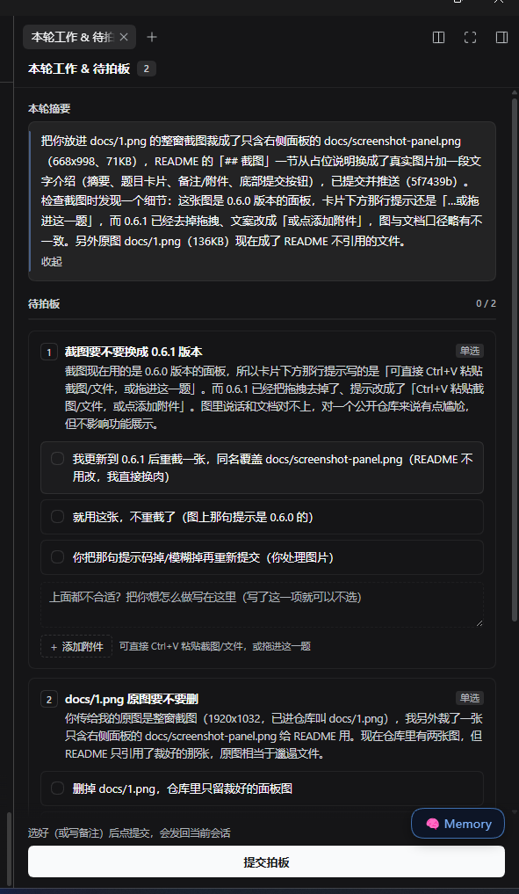

# dsh-work-summary-gate · 本轮工作 & 待拍板

[](./LICENSE)
[](https://dsh-plugin.org)

**装上它之后**：AI 每轮不再在正文里堆一长串"需要你拍板的问题"，而是把「本轮总结 + 待决问题」收进右侧边栏的一个 tab —— 你一次选完、每题都能写备注、点一下提交，答案自动带着问题标题发回会话，AI 接着干活。

> 解决的核心痛点：多轮开发里 AI 经常一次抛出 3~5 个决策点，散落在正文里，容易漏答、答错题号；回传时 AI 又容易忘记"q1 到底问的是什么"。

---

## 功能

- **右侧独立面板**：本轮摘要 + 全部待决问题集中一处，不再淹没在正文里
- **单选 / 多选**：按问题类型渲染，勾选框区分圆形（单选）与方形（多选）
- **每题一个常驻备注框**：选项都不满意？**不选任何选项、只写一句自己的想法也能提交**
- **提交前校验**：既没选、也没写备注的题会被标红拦住，不会漏答
- **回传带问题标题**：`q1（问题标题）: 选 b「…」；整题备注：…`，AI 拿到就能对上题
- **提交后自动收起侧边栏**：把注意力还给 AI 的回复
- **提交后只读回放**：已提交的轮次把「选了哪几项、每题备注、整体补充」原样列出来，核对时不用翻聊天记录
- **防重复提交**：同步锁 + "本轮已提交"双闸，连点/关掉再开都不会重复发送
- **失败可重试**：发送失败保留已填内容，一键重试
- **中英双语**：文案走 locale 表，跟随 DSH 语言

---

## 安装

> 前置：已安装 [DeepSeek Harness (dsh)](https://github.com/deepseek-ai/deepseek-harness) CLI，并使用 **web** profile（`dsh web`）。

### 方式一：从 npm（推荐，会出现在 DSH 插件中心）

```bash
dsh plugin --profile web add dsh-work-summary-gate
```

### 方式二：直接从 GitHub 源码安装

```bash
dsh plugin --profile web add github:tdcy/dsh-work-summary-gate
```

安装完成后**重启 `dsh web`**（宿主半部在启动时加载）。

---

## 使用

1. 正常对话。每轮结束时 AI 会调用 `gate_ask` 工具登记摘要与问题。
2. 聊天流里只出现一行卡片：`📋 本轮有待拍板项，见右侧面板`，同时右侧自动打开「本轮工作 & 待拍板」。
3. 逐题选择；**如果选项都不合适，直接在那一题的备注框里写你的想法**（此时可不选）。
4. 点「提交拍板」→ 回传自动发回当前会话 → 面板自动收起。
5. 面板被关掉后，点会话页头右侧的「拍板」按钮可重新打开；已提交的轮次不会再让你重复提交。

---

## 截图

> 建议放 1~2 张（面板展开 / 提交后收起）。
>
> ```markdown
> 
> ```

*(仓库里暂未附带截图；你把图片放到 `docs/` 并把上面这行取消注释即可。)*

---

## 它是怎么工作的

```
模型每轮结束前调用工具 gate_ask({ summary, questions })
        ↓
聊天流里只显示一行卡片：📋 本轮有待拍板项，见右侧面板  [打开面板]
        ↓
页头探针从 tool-result 的 argsRaw 解析出 gate，写入模块 store
        ↓
自动打开右侧 tab「本轮工作 & 待拍板」
        ↓
用户选选项 / 写整题备注 → 点「提交拍板」
        ↓
ctx.sessions.scope(sessionId).conversation.send("【拍板回传】…")
        ↓
面板自动收起，AI 继续干活
```

### 为什么用工具调用而不是正文标记块

v0.1 用 `<!-- dsh-gate:start … -->` 标记块，但 DSH 的聊天渲染器会把 HTML 注释**原样转义显示**，聊天流里会出现一大坨 JSON。改成工具调用后：聊天里是标准工具卡片（只显示一行），参数是结构化 JSON，客户端从 `argsRaw` 解析，不用从正文抠文本。

---

## 回传格式

```
【拍板回传】
q1（学生全流程收尾做哪些）: 选 b「…」、c「…」；整题备注：优先做风险低的
q2（推进节奏）: 选 a「做完一项再汇报」
（整体补充：……）
```

- 保留题号 + 问题标题 + 选项 id：AI 才能既对上"哪道题"，也知道"选了什么"
- `未选项；整题备注：…` 表示用户否掉了所有选项、按备注执行

---

## 文件结构

| 文件 | 作用 |
|---|---|
| `index.js` | **宿主半部**：注册 `gate_ask` 工具 + 注入系统提示词规则 |
| `client.js` | **浏览器半部**：解析、页头探针、右侧 tab、面板 UI、提交与回传 |
| `cordis.patch.yml` | 组合补丁：向 DSH 插件表插入本插件一行 |
| `locale/zh.json`、`locale/en.json` | 界面文案 |
| `icon.svg` | 插件图标 |
| `design/ui-spec.md` | 面板设计与交互规格（设计文档，可选读） |

---

## 权限与外部服务

- **不发起任何网络请求**：不访问第三方接口、不上传任何数据
- **不读写你的文件**：只在 DSH 客户端界面里渲染，不碰工作区文件
- **唯一的外部交互**：把「拍板回传」文本发回**当前会话**（走 DSH 自己的发送通道）
- **唯一注册的宿主能力**：一个工具（`gate_ask`）与一段系统提示词规则

---

## 兼容性

| 项 | 说明 |
|---|---|
| DSH 目标版本 | 在 **0.2.1-rc.2（nightly）** 桌面端 + `dsh web` 上验证 |
| profile | **web**（插件为 Web UI 专用：`package.json` 里声明了 `dsh.client.platform = "web"`） |
| 平台 | Windows / macOS / Linux（纯 JS，无原生依赖） |
| 依赖 | 无第三方运行时依赖（`react` 由 DSH 宿主提供） |

> ⚠️ 当前 **不支持仅桌面端（Electron 本地文档）** 的加载方式：那是 DSH 桌面端的界面载体差异，不是插件自身的选择。

---

## 版本

| 版本 | 内容 |
|---|---|
| 0.5.0 | ① 提交后**只读回放**（选项、每题备注、整题备注、整体补充；关掉面板再打开也看得到）② 删掉遗留的 `CSS` / `CSS2` 两份死样式，全插件只留一份 `<style>` ③ 补全中英文字典并真正注册给 locale 服务（英文界面不再回落成中文） |
| 0.4.1 | ① 每题常驻备注框（不选也能提交）② 回传带上问题标题 ③ 提交后自动收起右侧栏 ④ 防重复提交（同步锁 + 本轮已提交闸） |
| 0.4.0 | 按 `design/ui-spec.md` 重做面板：头/尾固定、只有中间滚动；主按钮反色；勾选框改 CSS 圆/方；题号徽标、进度条、未选校验、错误条 + 重试 |
| 0.3.0 | 发送通道修复（`binding.session.prompt` 优先、`conversation` 兜底）+ 页头常驻「拍板」入口 |
| 0.2.0 | 改用工具 `gate_ask` 登记，聊天流里只显示一行卡片 |
| 0.1.0 | 首版：正文标记块 + 右侧 tab |

---

## 已知边界

- 宿主半部（`index.js`）改动**需要重启 DSH** 才会重新加载工具与提示词；客户端改动刷新页面即可。
- `ctx.sidebarRight` 不在客户端服务目录里，自动开 tab 用 `ctx.get('sidebarRight')` 懒取；拿不到就只注册 tab、不自动弹。
- 收起侧边栏依赖 `sidebarRight.actionsFor(sessionId).setExpanded(sessionId,false)`（内部面），DSH 升级若改名会退化为"不自动收起"，不影响提交。
- 残留的 v0.1 文本标记块解析仍保留，作为兼容路径。

---

## 许可证

[MIT](./LICENSE) © 2026 tdcy

本项目为社区插件，与 DeepSeek AI 无隶属关系。
